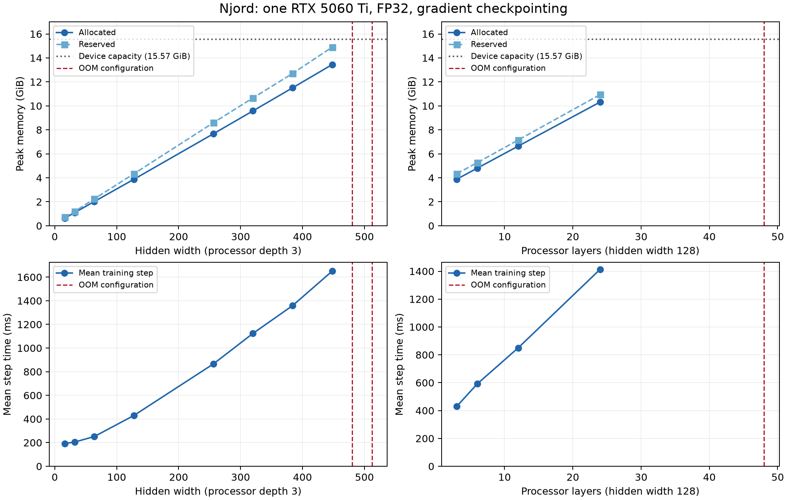
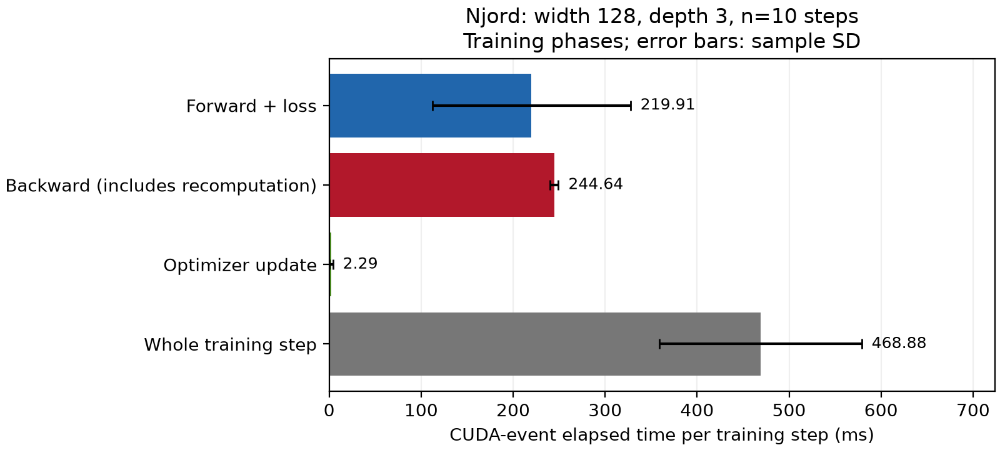
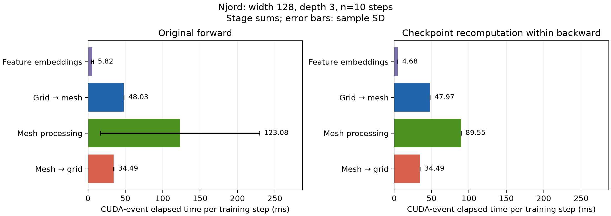
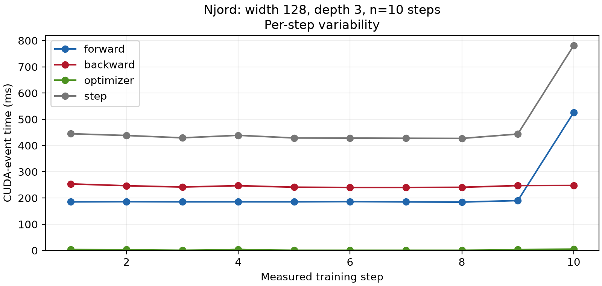
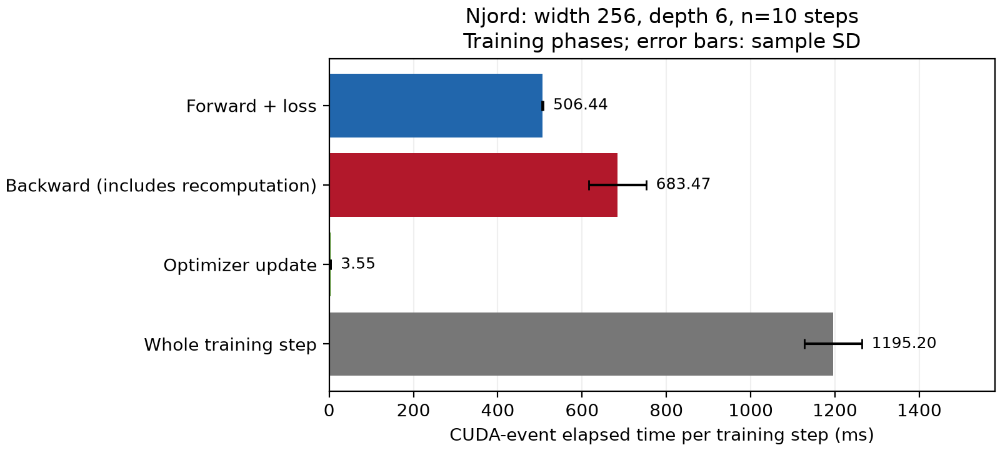
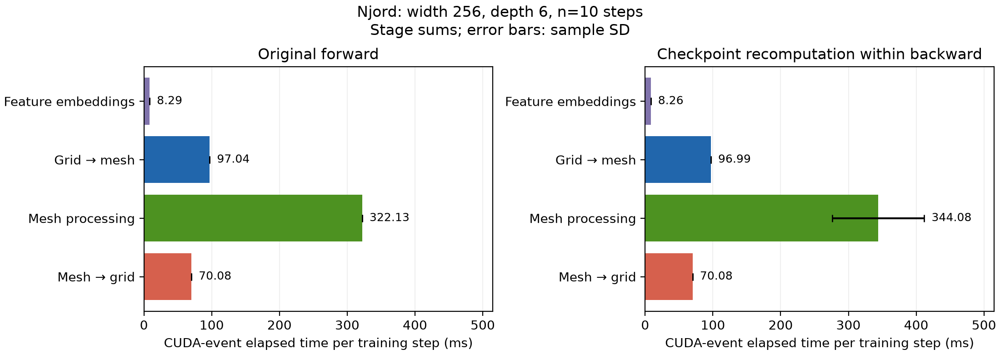

# Njord: single-GPU memory and runtime baseline

28 October 2026

With gradient checkpointing enabled, hidden width **448 succeeds and 480 fails**
at processor depth 3. At width 128, processor depth **24 succeeds and 48 fails**.
These are observed scaling boundaries for the configuration below, rather than
exact maximum supported sizes.

## Objective and setup

The objective is to measure training memory and runtime before implementing
multi-GPU parallelism. Njord is named `graph_efm` in this repository.

| Setting | Value |
|---|---|
| GPU | One NVIDIA GeForce RTX 5060 Ti; 15.57 GiB device memory |
| Software | PyTorch `2.14.1+cu130`; CUDA module `13.0` |
| Dataset | 1° global ocean sample; `sample_data/global_ocean_1.yaml` |
| Graph | `global_hierarchical_graph`; 42,348 grid nodes and 9,005 mesh nodes |
| Mesh hierarchy | 7,193 nodes at level 0; 1,812 at level 1 |
| Precision | FP32 (`32-true`); float32 matrix multiplication precision set to `high` by the training entry point |
| Training | AdamW, learning rate 0.001, batch size 1, one forecast step |
| Loss configuration | KL weight 0.1; CRPS disabled |
| Checkpointing | Enabled for the complete forecast step |
| Other depths | Encoder and prior processor layers fixed at 1 |

Width experiments vary `hidden_dim`; grid, mesh-node, and edge hidden dimensions
inherit this value. Depth experiments vary `processor_layers` at width 128.
The graph and all other settings remain fixed.

## Measurement method

[profile.sh](profile.sh) starts a fresh Python process for each width. Profiling
uses three warmup batches followed by ten measured batches. Validation and model
checkpoint saving are disabled. CUDA synchronization before and after each
training batch ensures queued GPU work completes before elapsed time is recorded.

- **Step time:** mean wall time for forward and loss computation, backward
  including checkpoint recomputation, and optimizer updates. Data loading,
  transfers to the GPU, startup, and epoch transitions are outside the interval.
- **Peak allocated memory:** maximum memory tracked as allocated by PyTorch
  across the run, including warmup and Adam state initialization.
- **Peak reserved memory:** maximum memory held by PyTorch's caching allocator,
  including reusable space. It includes allocated memory; the columns must not
  be added together. CUDA context and some library memory are outside these counters.
- **OOM:** CUDA out-of-memory failure. Reported memory is the peak reached before
  failure, excluding the unsuccessful allocation; runtime is unavailable.

Each configuration was run once. Successful configurations completed all ten
measured batches; OOM configurations completed none of the measured batches and
could have failed during warmup. The short sample dataset can span multiple epochs.

## Results



*Points show successful runs. Dashed red lines identify failed configurations;
they do not indicate measured memory requirements or runtimes. The horizontal
memory line is device capacity, not a budget fully available to PyTorch tensors.*

### Width scaling: processor depth 3

| Hidden width | Parameters (millions) | Mean step time (ms) | Peak allocated (GiB) | Peak reserved (GiB) | Status |
|---:|---:|---:|---:|---:|---|
| 16 | 0.052 | 192.6 | 0.63 | 0.71 | Success |
| 32 | 0.191 | 204.6 | 1.09 | 1.19 | Success |
| 64 | 0.733 | 251.8 | 2.02 | 2.25 | Success |
| 128 | 2.866 | 430.2 | 3.88 | 4.34 | Success |
| 256 | 11.335 | 865.2 | 7.67 | 8.59 | Success |
| 320 | 17.671 | 1123.8 | 9.58 | 10.66 | Success |
| 384 | 25.408 | 1358.9 | 11.51 | 12.71 | Success |
| 448 | 34.545 | 1651.0 | 13.45 | 14.90 | Success |
| 480 | 39.639 | — | 14.13* | 15.24* | OOM |
| 512 | 45.084 | — | 14.10* | 15.21* | OOM |

*OOM values are partial peaks before failure.*

From width 128 to 448, allocated memory increases by 3.46× and step time by
3.84×. At width 448, reserved memory reaches 14.90 GiB on a 15.57 GiB device.
The closest tested width boundary is therefore a successful 448 and a failing 480.

### Depth scaling: hidden width 128

| Processor layers | Parameters (millions) | Mean step time (ms) | Peak allocated (GiB) | Peak reserved (GiB) | Status |
|---:|---:|---:|---:|---:|---|
| 3 | 2.866 | 430.2 | 3.88 | 4.34 | Success |
| 6 | 3.907 | 591.4 | 4.80 | 5.26 | Success |
| 12 | 5.990 | 850.2 | 6.64 | 7.15 | Success |
| 24 | 10.156 | 1413.8 | 10.32 | 10.94 | Success |
| 48 | 18.487 | — | 14.98* | 15.34* | OOM |

*OOM values are partial peaks before failure.*

Increasing processor depth from 3 to 24 increases allocated memory by 2.66×
and runtime by 3.29×. Both increase approximately linearly over these tested
depths, with a fixed cost from the rest of the model. The closest tested depth
boundary is a successful 24 and a failing 48.

## Detailed phase and stage timings

### Width 128, processor depth 3

A separate instrumented run, [job 1647](reports/baseline/stages-1647/results.csv), measures
width 128 and processor depth 3 using CUDA events. It retains the same model,
precision, checkpointing, and loss settings, with 3 warmup and 10 measured steps.
The existing CUDA synchronization at batch end resolves all timing events;
individual stages do not introduce additional synchronization.



| Phase | Mean CUDA-event time (ms) | Sample SD (ms) |
|---|---:|---:|
| Forward + loss | 219.91 | 107.63 |
| Backward, including checkpoint recomputation | 244.64 | 4.54 |
| Optimizer update | 2.29 | 1.82 |
| Whole training step | 468.88 | 110.01 |

Optimizer timing starts after Lightning's forward/backward closure and ends at
the optimizer's post-step hook. This avoids counting forward/backward twice.
The whole-step interval also includes framework work outside these phases.
The synchronized wall-time mean is 468.96 ms, and peak allocated memory remains
3.88 GiB. These instrumented timings are separate from the earlier baseline;
their difference does not isolate instrumentation overhead because they are
independent runs with different runtime variability.



| Selected stage | Original forward mean ± SD (ms) | Checkpoint replay mean ± SD (ms) |
|---|---:|---:|
| Feature embeddings | 5.82 ± 1.36 | 4.68 ± 0.11 |
| Grid-to-mesh | 48.03 ± 0.12 | 47.97 ± 0.02 |
| Mesh processing | 123.08 ± 106.47 | 89.55 ± 0.02 |
| Mesh-to-grid | 34.49 ± 0.01 | 34.49 ± 0.02 |

Grid-to-mesh sums the encoder, decoder, and prior calls, approximately 16 ms
each in the original forward. Mesh processing includes same-level GNN sequences
and up/down hierarchy propagation across those components. Mesh-to-grid belongs
to the decoder. These categories cover disjoint selected scopes, rather than
every operation in the model; projections, distribution operations, and loss
bookkeeping outside those scopes are excluded.

**Checkpoint replay is only part of backward.** The right-hand stage panel
measures forward operations executed again inside backward, not each stage's
gradient kernels. Gradient computation is included in the total backward time.
The stage bars must therefore not be described as a complete per-stage backward
breakdown. Replay can stop partway through a module when its last needed tensor
has been reconstructed.



Measured step 10 has a 526.20 ms forward interval, versus 184.46–190.20 ms in
the preceding nine steps. The long interval is within
`decoder.intra_down_gnns.0` (365.21 ms). The sample is retained in all means and
standard deviations. CUDA events measure elapsed intervals on the current
stream, including possible CPU launch gaps; this observation does not establish
that a kernel itself became slower. A valid Nsight timeline is needed to explain
the outlier. No hardware compute/bandwidth bottleneck classification is inferred
from these interval timings alone.

Reproduce and regenerate the PNG/PDF figures with:

```bash
sbatch profile_stages.sh
python scripts/plot_stage_profile.py reports/baseline/stages-1647/results.csv \
  --output-dir figures/stages-1647
# Optional replacement Nsight capture, using the annotated profiling path:
NSYS=1 sbatch profile_stages.sh
```

Per-step data are in [results.phases.csv](reports/baseline/stages-1647/results.phases.csv)
and [results.stages.csv](reports/baseline/stages-1647/results.stages.csv); the latter retains
module names for encoder/prior/decoder attribution. The successful run logs
means under `timing/` in
[W&B](https://forge.coreweave.com/wandb/nrottstegge-eth-z-rich/baltic-sea-forecasting/runs/mz2k3yao).
See [PROFILING.md](PROFILING.md) for timing boundaries and configuration options.

### Width 256, processor depth 6

[Job 1649](reports/baseline/stages-1649/results.csv) successfully completed all ten
measured steps. Peak allocated memory is **9.52 GiB**, peak reserved memory is
**10.48 GiB**, and mean synchronized wall time is **1195.25 ms per step**.



| Phase | Mean CUDA-event time (ms) | Sample SD (ms) |
|---|---:|---:|
| Forward + loss | 506.44 | 1.16 |
| Backward, including checkpoint recomputation | 683.47 | 68.15 |
| Optimizer update | 3.55 | 0.002 |
| Whole training step | 1195.20 | 68.03 |



| Selected stage | Original forward mean ± SD (ms) | Checkpoint replay mean ± SD (ms) |
|---|---:|---:|
| Feature embeddings | 8.29 ± 0.07 | 8.26 ± 0.04 |
| Grid-to-mesh | 97.04 ± 0.04 | 96.99 ± 0.03 |
| Mesh processing | 322.13 ± 0.05 | 344.08 ± 67.89 |
| Mesh-to-grid | 70.08 ± 0.03 | 70.08 ± 0.03 |

Mesh processing is the largest selected forward stage, accounting for about
**64% of forward elapsed time** in this run. This makes it a useful starting
point for investigating model partitioning; elapsed intervals alone do not
identify a hardware bottleneck. Backward accounts for approximately 57% of the
whole-step interval and includes replay as well as gradient computation.

The [per-step figure](figures/stages-1649/steps-w256-d6.png) shows a
backward outlier at measured step 7: 877.39 ms, compared with 660.24–664.87 ms
in the other steps. Mesh replay is correspondingly elevated to 537.31 ms in
that step. The outlier is retained in the means and SDs. Its cause requires a
timeline; these measurements cannot distinguish a longer-running kernel from
host-side launch gaps.

Compared with job 1647, mean wall time increases by 2.55× and allocated memory
by 2.45×. **Both width and depth changed**, so this comparison cannot isolate
the effect of either dimension; the earlier controlled sweeps serve that purpose.
The same stage-backward attribution limits described above apply here.

Raw data: [phases](reports/baseline/stages-1649/results.phases.csv),
[stages](reports/baseline/stages-1649/results.stages.csv), and
[W&B run](https://forge.coreweave.com/wandb/nrottstegge-eth-z-rich/baltic-sea-forecasting/runs/zwnlwwiy).
PNG and PDF figures are stored in `figures/stages-1649/`.

## Nsight Systems capture inspection

The local SQLite export `output/baseline.sqlite` and original capture
`output/baseline.nsys-rep` were inspected separately from the
scaling runs. These large diagnostic artifacts are excluded from Git.
Capture metadata specifies width 64, batch size 1, FP32, AdamW,
one forecast step, gradient checkpointing, and one epoch. However, the launch
command **does not include `--profile_steps`**, so it follows the ordinary
training path, whose default strategy is DDP, rather than the single-GPU
profiling path. The custom NVTX `profile` range is consequently absent.

| Captured evidence | Observation |
|---|---|
| Session duration | Approximately 17.74 s, including initialization and teardown |
| CUDA kernels | Only 5, all PyTorch `FillFunctor` elementwise kernels |
| Sum of kernel durations | 3.872 microseconds across all 5 kernels |
| GPU memory copies | 133 operations transferring 24,496 bytes in total |
| NVTX events | 8 records, all associated with NCCL; no `profile` training range |
| NCCL initialization | `ncclCommInitRankConfig` range lasts approximately 729 ms |
| CUDA memory usage tracing | Disabled in capture metadata |

**This capture does not establish training bottlenecks.** The recorded work is
consistent with initialization and teardown; there are no recorded matrix
multiplication or graph message-passing kernels from which to analyze a training
step. The tiny kernel and copy totals must not be interpreted as the model's GPU
utilization, transfer cost, or training runtime. NCCL events indicate distributed
runtime setup, not communication between multiple GPUs in these experiments.
The available trace does not establish whether the application failed before
training or whether additional work was missed by the profiler; the application
stdout/stderr logs are needed to determine that.

The capture also records a compatibility warning: Nsight Systems **2025.3.2**
does not support the installed CUDA driver version **13.4**, and falls back to
tracing libraries for driver version **13.1**. This warning adds uncertainty to
the trace and should be resolved before collecting a replacement. Check
`nsys --version` inside the GPU allocation after loading CUDA modules, since
module loading can select a different profiler executable.

For a replacement capture, use a compatible Nsight build and the command below
inside the activated GPU environment. It selects the same width-64 configuration
as the supplied trace but explicitly enables the bounded single-GPU profiling
path. Keep its results separate from the runs without Nsight.

```bash
nsys --version
nsys profile --trace=cuda,nvtx,osrt --sample=none \
  -e NSYS_NVTX_PROFILER_REGISTER_ONLY=0 \
  --capture-range=nvtx --nvtx-capture=profile --capture-range-end=stop \
  -o output/baseline-training \
  python -m neural_lam.train_model \
  --config_path sample_data/global_ocean_1.yaml \
  --model graph_efm --graph global_hierarchical_graph \
  --hidden_dim 64 --processor_layers 3 --batch_size 1 --num_workers 2 \
  --optimizer adamw --kl_beta 0.1 --crps_weight 0 \
  --precision 32-true --ar_steps_train 1 \
  --profile_warmup 3 --profile_steps 3 \
  --profile_output output/nsight-profile.csv
```

A usable replacement should contain the NVTX `profile` range and substantial
training kernel activity. Kernel-time breakdowns and CPU/GPU gaps can then be
analyzed; identifying the responsible model stage still requires finer NVTX
annotations or other attribution. No such breakdown is supported by the current
capture.

## Interpretation and limits

Checkpointing is implemented by
[ARModel.unroll_ckpt_func](neural_lam/models/ar_model.py) and called by
[GraphEFM.training_step](neural_lam/models/graph_efm.py). It recomputes work during
backward instead of retaining all internal activations across the checkpointed
region. However, the temporary tensors needed while executing that region and
its backward pass must still fit on one GPU. Increasing width or depth eventually
exceeds that capacity even with one forecast step and batch size 1.

These measurements establish a memory barrier for scaling this configuration
on one GPU and provide a baseline for future model partitioning. They do not
identify which model stage or tensor causes the peak. A replacement Nsight
training trace and stage-specific memory measurements would help distinguish
grid-to-mesh, mesh processing, and mesh-to-grid costs before selecting a
parallelization strategy. The supplied capture only supports the initialization
observations above.

The results apply to this graph, resolution, precision, and loss configuration.
Graph-size scaling, the 0.25° dataset, longer rollouts, other training phases,
and forecast accuracy were not evaluated. No comparison without checkpointing
was run, so its memory savings and runtime overhead are not quantified here.
Ten measured batches from one run provide an initial baseline, with no error
bars in the scaling sweeps or guarantee of stability over long training.
Detailed timing figures separately show sample variability within one run.
No training-kernel bottleneck
classification or multi-GPU speedup is claimed.

## Reproduction and source data

Run from the repository root with the cluster environment used by `profile.sh`:

```bash
# Initial and refined width sweeps; each stops at its first OOM.
WANDB_MODE=online sbatch profile.sh
WIDTHS="320 384 448 480" WANDB_MODE=online sbatch profile.sh

# Depth sweep; the depth-3 reference comes from the first width sweep.
for depth in 6 12 24 48; do
  WIDTHS=128 WANDB_MODE=online sbatch profile.sh --processor_layers "$depth"
done
```

The default width list includes 1024, but the initial sweep stopped at 512;
width 1024 was not tested.

| Experiment | CSV |
|---|---|
| Initial width sweep; depth-3 reference | [Job 1613](reports/baseline/profile-1613/results.csv) |
| Refined width sweep | [Job 1615](reports/baseline/profile-1615/results.csv) |
| Depth 6 | [Job 1617](reports/baseline/profile-1617/results.csv) |
| Depth 12 | [Job 1618](reports/baseline/profile-1618/results.csv) |
| Depth 24 | [Job 1619](reports/baseline/profile-1619/results.csv) |
| Depth 48 | [Job 1620](reports/baseline/profile-1620/results.csv) |

Job 1609 is excluded because W&B logger initialization failed before training.
Measurements use repository base revision
`76b30d778382939963219142053fcf6f2d54c54e` with local changes in
`train_model.py`, `custom_loggers.py`, and the added profiling script and callback
([profile_baseline.py](neural_lam/profile_baseline.py)).

The selected CSV snapshots and report figures are versioned in
`reports/baseline/` and `figures/`. Working logs and raw profiler captures under
`output/` are local artifacts and are excluded from Git.
