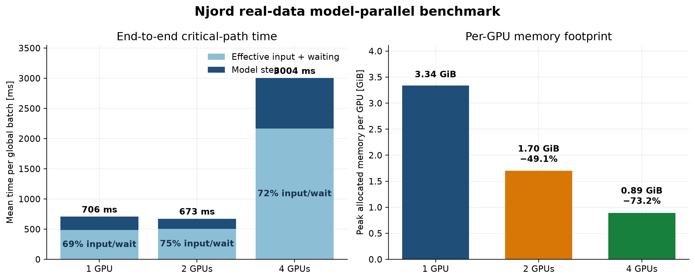
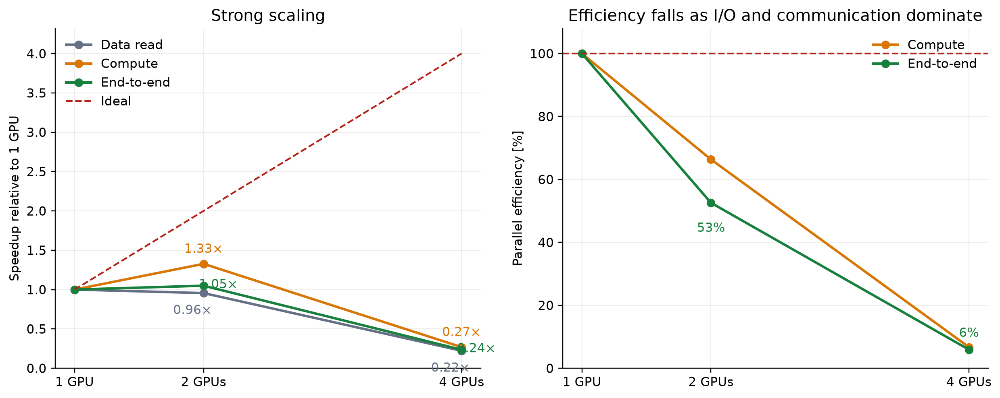
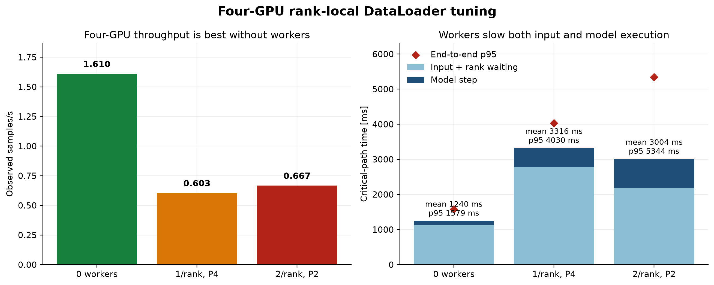
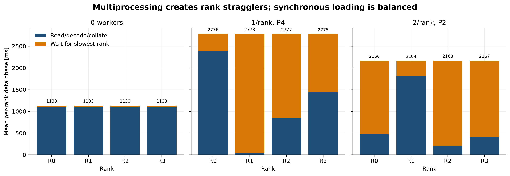
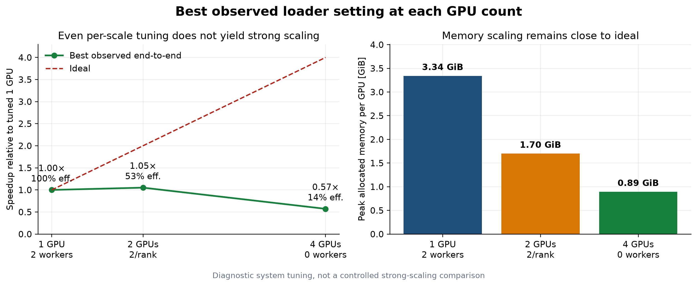

# Model-parallel real-data benchmark analysis

## Scope

This report analyses the archived 238-step real-data runs produced by the
model-parallel benchmark. The benchmark workload uses:

- GTX 1080 Ti GPUs on one student-cluster node;
- global batch size 2 and one autoregressive step;
- hidden size 64 for grid, mesh, and edge representations;
- two processor layers;
- rank-local geographic Zarr shards staged to `$TMPDIR` before measurement;
- a fixed global problem size for the 1-, 2-, and 4-GPU runs.

The 2-worker/prefetch-2 series was run on benchmark commit `b0b39ad`. The
archived results and this analysis are based on repository commit `390f480`.

## Result validity

- Every result completed successfully and contains 238 measured steps.
- For each GPU count, all DataLoader variants have the same preflight batch
  fingerprint.
- Preflight loss ranges only from 40,980,616 to 40,980,620.
- The relative range of the measured mean loss is approximately 4.8e-8.
- Owned interior grid nodes are exactly balanced between ranks.

The experiments therefore compare the same numerical workload. They verify
one-step training consistency, but they do not replace a forecast-accuracy
evaluation over complete validation rollouts.

## Controlled strong scaling with zero workers

| GPUs | Throughput [samples/s] | Speedup | Efficiency | Data [ms] | Model step [ms] | End-to-end [ms] | Memory/GPU [GiB] |
|---:|---:|---:|---:|---:|---:|---:|---:|
| 1 | 1.221 | 1.000x | 100.0% | 1,411.0 | 224.1 | 1,635.1 | 3.34 |
| 2 | 1.474 | 1.207x | 60.3% | 1,224.8 | 155.4 | 1,354.5 | 1.70 |
| 4 | 1.660 | 1.360x | 34.0% | 1,105.8 | 157.7 | 1,202.2 | 0.89 |

This is a valid controlled comparison because the loader configuration is
unchanged. Four GPUs improve end-to-end throughput by 36%, but they do not
come close to ideal 4x scaling. The main benefit is memory: per-GPU allocated
memory falls by 73%.

## Controlled strong scaling with two workers per rank

| GPUs | Throughput [samples/s] | Speedup | Efficiency | Data [ms] | Model step [ms] | End-to-end [ms] | Memory/GPU [GiB] |
|---:|---:|---:|---:|---:|---:|---:|---:|
| 1 | 2.814 | 1.000x | 100.0% | 485.9 | 220.5 | 706.4 | 3.34 |
| 2 | 2.960 | 1.052x | 52.6% | 506.4 | 167.3 | 673.3 | 1.70 |
| 4 | 0.667 | 0.237x | 5.9% | 2,180.2 | 835.9 | 3,004.2 | 0.89 |

Two workers per rank help one and two GPUs, but fail badly at four GPUs. With
the current allocation, four GPUs create eight loader workers in addition to
four training ranks on eight allocated CPU cores. The result is CPU and I/O
contention, large rank stragglers, and slower GPU execution while workers are
active.

## Four-GPU DataLoader sensitivity

| Workers per rank | Prefetch | Throughput [samples/s] | Data [ms] | Model step [ms] | End-to-end mean [ms] | End-to-end p95 [ms] |
|---:|---:|---:|---:|---:|---:|---:|
| 0 | - | 1.610 | 1,134.6 | 105.4 | 1,240.0 | 1,579.1 |
| 1 | 4 | 0.603 | 2,785.2 | 537.5 | 3,316.1 | 4,030.4 |
| 2 | 2 | 0.667 | 2,180.2 | 835.9 | 3,004.2 | 5,344.1 |

The zero-worker result is the clear four-GPU winner. A second zero-worker
four-GPU run on another node produced 1.660 samples/s instead of 1.610
samples/s, a difference of approximately 3%, so the conclusion also holds
across the two observed nodes.

With zero workers, all ranks spend approximately 1.1 seconds in their data
phase. With multiprocessing, one rank becomes the slow reader and the other
ranks wait at the synchronization point. The identity of the slow rank
changes with the worker configuration, which is evidence against geographic
partition size being the cause.

## Best observed configuration per GPU count

| GPUs | Loader setting | Throughput [samples/s] | Relative speedup | Efficiency |
|---:|---|---:|---:|---:|
| 1 | 2 workers, prefetch 2 | 2.814 | 1.000x | 100.0% |
| 2 | 2 workers/rank, prefetch 2 | 2.960 | 1.052x | 52.6% |
| 4 | 0 workers | 1.610 | 0.572x | 14.3% |

This table is an operational comparison, not a controlled strong-scaling
result, because the loader configuration changes with GPU count. It shows
that the best current two-GPU run is only 5% faster than the best one-GPU run,
while the best four-GPU run is slower than the tuned one-GPU run.

## Interpretation

1. **The partitioning works for memory.** Memory per GPU decreases from 3.34
   GiB to 1.70 GiB and 0.89 GiB. This is close to ideal spatial memory scaling.
2. **Multi-GPU compute is not useless.** In the controlled zero-worker series,
   the mean model step drops from 224.1 ms to 157.7 ms. Communication and
   imbalance prevent ideal scaling, but there is real compute acceleration.
3. **The end-to-end benchmark is input-bound.** At four GPUs with zero workers,
   the data phase consumes about 92% of the 1.20-second step. Host-to-device
   transfer is only about 1 ms and is not the bottleneck.
4. **More workers are not automatically better.** Workers compete for the same
   CPU cores, memory bandwidth, and local-storage path. At four GPUs this also
   slows forward, backward, gradient synchronization, and optimizer timing.
5. **Rank-local Zarr shards removed the old rank-0 broadcast path, but not the
   physical I/O volume.** All ranks still read and decompress their spatial
   share of every sample from the same node resources.
6. **The current workload is compute-light.** Hidden size 64, two processor
   layers, batch size 2, and one autoregressive step leave little GPU work with
   which to amortize input and communication overhead.
7. **The graph is balanced by owned nodes, not by all work.** Four-GPU halo
   counts range from 404 to 1,262 nodes. Relation-specific edge work and halo
   traffic must be measured before attributing the remaining compute gap.

## Quantitative bottleneck diagnosis

### Why the zero-worker result is the clean performance baseline

The zero-worker series keeps the same input policy at every GPU count and is
therefore the clearest strong-scaling result. It shows two effects at once:

- model-step time improves from 224.1 ms to 157.7 ms at four GPUs, a 1.42x
  compute-path speedup;
- data time improves only from 1,411.0 ms to 1,105.8 ms, a 1.28x input-path
  speedup.

The slower-scaling input path dominates the faster-scaling model path, so the
combined speedup stops at 1.36x. This is an Amdahl-style limit caused by the
measured workload composition, not proof that graph partitioning has no value.

The zero-worker four-GPU result was also repeated on another node. Throughput
changed from 1.660 to 1.610 samples/s and end-to-end time from 1,202 to 1,240
ms. The approximately 3% node-to-node difference is much smaller than the
worker-induced slowdown, which makes the worker conclusion robust.

### Why the worker failure is not a partition-size failure

Each four-GPU partition owns exactly 10,587 interior grid nodes. With zero
workers, the four rank-local data phases are all approximately 1,133 ms. With
one worker per rank, per-rank read/queue time ranges from about 49 to 2,386 ms;
with two workers per rank it ranges from about 201 to 1,815 ms. The rank that
becomes slow changes between configurations.

If geographic shard size were the main cause, the same rank would remain slow
and zero-worker reads would already be imbalanced. Instead, the result is
consistent with competition between training ranks and worker processes for:

- the eight allocated CPU cores;
- memory bandwidth and decompression capacity;
- the same node-local storage device and filesystem metadata path;
- Python process scheduling and DataLoader queues.

For the two-worker four-GPU run there are eight worker processes plus four
training ranks on eight allocated CPU cores. Compared with zero workers:

- data-path time increases by approximately 92%;
- model-step time increases by approximately 693%;
- throughput falls by approximately 59%;
- end-to-end p95 rises from 1.58 to 5.34 seconds.

The model-step increase is especially important. Workers continue preparing
future batches while the GPU step runs, so they can slow CPU launches, memory
operations, and distributed progress even when their own time is reported in
the data phase.

### What the memory result proves

Ideal spatial partitioning would reduce 3.34 GiB to 1.67 GiB on two GPUs and
0.84 GiB on four GPUs. The measured values are 1.70 and 0.89 GiB. The excess
over the ideal values is only about 2% and 7%, respectively, which is expected
from replicated parameters, buffers, and communication metadata.

This is already a successful outcome: the implementation enables larger
models or batches even before it provides proportional throughput scaling.

### What is still unknown

The current result does not tell us:

- the compute-only scaling of message passing without Zarr;
- how much of `data_read_ms` is storage, decompression, transformation,
  collation, or queue waiting;
- the isolated time and bytes for each graph relation's halo exchange;
- whether hidden size 128 or 256 changes the compute/communication balance;
- whether the halo-count imbalance translates into a comparable edge-compute
  or communication imbalance;
- whether a full autoregressive validation rollout remains scientifically
  equivalent.

These unknowns determine the order of the next work. Optimizing communication
before measuring compute-only execution risks improving a secondary cost;
increasing model size before separating input and compute risks hiding I/O
rather than fixing or correctly characterizing it.

## Decision matrix

| Idea | Evidence from current runs | Expected value | Implementation cost | Priority |
|---|---|---|---|---|
| Separate input, compute, and end-to-end modes | Current timing mixes independent systems | Very high: makes every later conclusion interpretable | Low to medium | P0 |
| Preload rank-local working set into RAM | Zarr-side phase dominates; dataset is small enough | Very high diagnostic and likely performance gain | Low to medium | P0 |
| Split DataLoader/Zarr timers | `data_read_ms` remains a combined timer | High: identifies the actual storage/CPU target | Medium | P0 |
| Rechunk or change compression | Time chunks are currently one | Potentially high, but direction is not yet measured | Medium | P1 |
| Increase hidden size / processor depth | H64/L2 workload is compute-light | High for realistic scaling characterization | Low after arguments are exposed | P1 |
| Relation-level message-passing profile | Halo time is not isolated | High for the user's communication work package | Medium | P1 |
| Overlap halo communication and local MLP work | Architecture permits interior/boundary separation | Medium to high if communication is exposed | High | P2, gated by profiling |
| Weighted RCB / repartition graph | Owned nodes balance, halo nodes do not | Medium, team-relevant | High and shared with partitioning work | P2 |
| Async host-to-device transfer | Copy is only about 1-3 ms | Low under current conditions | Medium | P3 |
| Add more workers per rank | Four-GPU evidence is strongly negative | Negative under current CPU allocation | Low | Do not pursue |

## What should be done next

### 1. Separate input, compute, and end-to-end benchmarks

Add three explicit modes before doing more tuning:

- **input-only:** iterate rank-local samples and measure Zarr access, decode,
  transforms, collation, queue wait, and rank wait without model execution;
- **compute-only:** preload one or more physical batches into device or host
  memory and repeat the exact distributed forward/backward step without Zarr;
- **end-to-end:** keep the current realistic pipeline.

This is the highest-priority change. It answers whether message passing scales
independently of the input pipeline. Repeating a small set of real samples is
appropriate for this performance experiment as long as it is labelled
compute-only and is not used for accuracy claims.

**Implementation plan**

1. Add `--benchmark-mode input-only|compute-only|end-to-end` to
   `benchmarks/model_parallel_real.py` and record it in the result JSON.
2. Keep the existing `end-to-end` path unchanged as the reference.
3. For `input-only`, construct the real rank-local dataset and DataLoader but
   skip model construction after the metadata needed for validation is known.
   Consume batches, synchronize ranks, and record the complete input timing.
4. For `compute-only`, load four real batches before the measured window,
   validate their fingerprints, and cycle through them. Provide two submodes:
   host-resident batches including host-to-device copy, and device-resident
   batches excluding the copy.
5. Keep optimizer, gradient synchronization, and local-loss computation in the
   compute-only path. Otherwise it would measure inference rather than the
   current training step.
6. Store raw per-rank records for all modes, not only aggregated maxima.

**First experiment matrix**

| Mode | GPUs | Workers | H/L/B | Warmup | Measured steps | Repetitions |
|---|---|---:|---|---:|---:|---:|
| Input-only | 1, 2, 4 | 0 | 64/2/2 | 5 | 238 | 3 |
| Compute-only, host-resident | 1, 2, 4 | 0 | 64/2/2 | 10 | 238 | 3 |
| Compute-only, device-resident | 1, 2, 4 | 0 | 64/2/2 | 10 | 238 | 3 |
| End-to-end | 1, 2, 4 | 0 | 64/2/2 | 5 | 238 | 3 |

Here H/L/B means hidden size, processor layers, and global batch size.

**Decision rule**

- If compute-only scales materially better than end-to-end, keep the current
  distributed core and prioritize the input path.
- If compute-only also scales poorly, relation-level message-passing profiling
  moves ahead of storage optimization.
- If host-resident and device-resident results differ by only a few
  milliseconds, pinned copies and double buffering stay low priority.

### 2. Split the current data timer

`data_read_ms` currently combines several effects. Record at least:

- time waiting for a DataLoader result;
- Zarr chunk access;
- decompression;
- sample transforms and tensor construction;
- collation;
- rank synchronization;
- host-to-device transfer.

Also record bytes read, chunks touched, CPU utilization, and local-disk
throughput. Keep one-time `$TMPDIR` staging outside the per-step measurement.

**Instrumentation plan**

1. Measure DataLoader iterator wait around `next(iterator)` on every rank.
2. Inside the dataset path, measure index selection, xarray/Zarr materialization,
   NumPy-to-Torch conversion, normalization/transforms, and returned sample
   construction.
3. Use a timed custom `collate_fn` to isolate collation.
4. Keep the existing rank barrier measurement and host-to-device CUDA timing.
5. Add counters for logical tensor bytes and, where the store exposes them,
   compressed bytes and chunks touched.
6. Collect process CPU time, maximum RSS, and node-level read throughput at a
   low sampling rate so telemetry does not dominate short steps.

**Required output**

Each JSON result should contain per-rank mean, median, p95, and total time for
every substage. A stacked critical-path plot must use mutually exclusive
timers; independently aggregated rank maxima must not be added together.

### 3. Test an in-memory rank-local working set

The complete partitioned dataset is about 2 GiB per world-size layout, which is
small compared with the observed host-memory allocation. Load each rank's
required arrays or benchmark working set into RAM once, record that startup
cost separately, and run the input/compute/end-to-end modes again. This is the
fastest way to establish the maximum benefit available from removing Zarr
from the hot loop.

**Variant plan**

- `Z0`: current rank-local Zarr, zero workers;
- `R-all`: load the complete local shard into host RAM during startup;
- `R-ring`: keep a rotating host-memory cache of 8 or 16 prepared batches;
- `D-ring`: keep the same small batch ring on the GPU for compute-only runs.

For `R-all`, each rank must load only its own spatial shard. Startup load time
and maximum RSS are reported separately from steady-state steps. The sample
order and random seed must remain the same as in `Z0`.

**Decision rule**

- If `R-all` removes most of the approximately 1.1-second four-GPU input path,
  the bottleneck is definitively inside Zarr/decode/sample construction.
- If `R-all` remains slow, focus on transforms, collation, process scheduling,
  and synchronization rather than storage layout.
- If `R-ring` reaches almost the same throughput as `R-all`, a bounded cache is
  sufficient for realistic datasets that do not fit completely in RAM.

### 4. Tune storage layout with evidence

The generated shards currently use chunks of one for `time`, `init_time`, and
`lead_time`, and the full local size for every other dimension. Compare a
small matrix of layouts:

- temporal chunk sizes 1, 4, and 8;
- current compression versus uncompressed or lighter compression;
- zero workers and a node-level capped worker count;
- the current CPU allocation and, only if permitted, more CPU cores.

Do not start with asynchronous host-to-device copies: the copy is already
approximately 1-3 ms, so it cannot explain a 1-3 second data phase.

**Storage experiment design**

Create stores from the same source and partition manifest. Change only one
property at a time:

| Store | Time chunk | Spatial chunk | Compression |
|---|---:|---|---|
| C1 | 1 | full rank-local slice | current |
| C4 | 4 | full rank-local slice | current |
| C8 | 8 | full rank-local slice | current |
| C4-U | 4 | full rank-local slice | uncompressed |
| C4-L | 4 | full rank-local slice | lighter/faster codec |

Run input-only first on one and four GPUs with zero workers. The two best
stores then receive the complete 1/2/4-GPU end-to-end comparison. Record store
size as well as throughput: a layout that is fast but exceeds the course
storage budget is not a viable result.

For worker policy, treat workers as a node-wide CPU budget. Under the current
two-CPUs-per-GPU allocation, reserve at least one CPU execution context per
training rank. Do not repeat the eight-worker/four-rank configuration unless
the job can request and receive additional CPUs.

### 5. Run a controlled model-size sweep

After compute-only timing exists, expose hidden size, processor layers, and
batch size through the submission script. Change one dimension at a time:

1. hidden size 64, 128, and 256 with two processor layers and batch size 2;
2. processor layers 2, 4, and 6 at one selected hidden size;
3. batch size 2 and 4 where memory permits.

Hidden size increases both halo payload and MLP work, but MLP work grows faster
than the communicated feature width. Processor layers add repeated message
passing and communication. Batch size increases samples per step and can
amortize fixed launch and synchronization costs. These experiments determine
where multi-GPU execution becomes worthwhile for a more realistic model.

**Implementation plan**

Expose the following without editing the batch script for every run:

- `NJORD_HIDDEN_DIM`;
- `NJORD_PROCESSOR_LAYERS`;
- `NJORD_BATCH_SIZE`;
- `NJORD_AR_STEPS`.

Add them to result metadata and to the controlled-comparison validation.

**Sequential experiment plan**

1. Run compute-only H64/H128/H256 with L2, B2, and 1/2/4 GPUs.
2. Select the largest hidden size that fits on one GPU and compare L2/L4/L6.
3. At one representative H/L pair, compare B2 and B4.
4. Only the most informative configurations are repeated end to end.

This is deliberately not a full Cartesian sweep. It isolates causality and
avoids spending the four-GPU budget on redundant combinations.

For every point report:

- samples/s and model steps/s;
- forward, backward, gradient synchronization, and optimizer time;
- peak memory per GPU;
- halo bytes and communication time per relation;
- compute-only speedup and efficiency;
- arithmetic-intensity proxy: local edge-MLP work per communicated byte.

**Expected interpretation**

- Hidden size increases communicated feature width approximately linearly,
  while dense MLP work grows approximately quadratically. Scaling may therefore
  improve as hidden size grows.
- Processor depth repeats both local message computation and halo exchanges.
  It tests communication scalability more directly than hidden size.
- Batch size increases local compute and halo payload together, but can
  amortize fixed kernel-launch and synchronization overhead.

### 6. Profile message passing by relation

For compute-only runs, record the following separately:

- grid-to-mesh;
- same-level Mesh 0;
- Mesh 0 to Mesh 1;
- same-level Mesh 1;
- Mesh 1 to Mesh 0;
- mesh-to-grid;
- local edge MLP work, halo packing, communication, waiting, and aggregation.

Then overlap nonblocking halo transfers with interior-edge MLP work, reuse
static index and communication buffers, and combine small transfers where
possible. Measure boundary-edge and halo volume per rank so that later graph
partitioning can use compute and communication weights rather than node count
alone.

**Instrumentation plan**

For every relation and layer, add CUDA-event or profiler ranges for:

1. selecting and packing remote sender features;
2. posting sends and receives;
3. local interior-edge MLP computation;
4. waiting for halo completion;
5. boundary-edge MLP computation;
6. aggregation/scatter;
7. receiver-node update;
8. reverse halo-gradient exchange.

Record sender nodes, receiver nodes, local edges, boundary edges, halo nodes,
messages, and bytes. The relation names must be stable across the prior,
posterior, and decoder so that results can be added without ambiguity.

**Overlap implementation plan**

1. Precompute disjoint interior-edge and boundary-edge index sets.
2. Start nonblocking halo exchange on a dedicated CUDA stream.
3. Execute interior-edge MLPs while the transfer is in flight.
4. Wait only before boundary-edge MLPs require the received features.
5. Combine interior and boundary aggregates using preallocated buffers.
6. Reuse static packing indices and communication buffers across steps.
7. Preserve the custom autograd reverse exchange and verify gradients against
   the synchronous path.

Compare synchronous and overlapped implementations on the same compute-only
batch, graph, partition, and commit. Continue only if the measured wait time
is large enough to hide and the new path reduces relation or step time without
increasing numerical error.

### 7. Use measured costs to evaluate partitioning

This work should be coordinated with the team members responsible for graph
partitioning rather than replacing their partitioning work.

**Plan**

1. Export per-relation local compute, boundary compute, halo bytes, and wait
   time from the message-passing profiler.
2. Use those values as weights in the partition viewer/cost model.
3. Compare the current geographic/RCB ownership with a weighted RCB objective
   that minimizes the maximum predicted rank time, not only node count.
4. For every candidate report owned-node balance, edge-work balance, halo-byte
   balance, predicted time, and measured compute-only time.
5. Select the partition only after it wins on measured execution, not merely
   on fewer cut edges.

**Decision rule**

A new partition must reduce critical-path model time or p95 without breaking
the near-ideal memory balance. Moving work from a slow rank to a fast rank is
useful even if the total number of halo nodes changes slightly.

### 8. Final measurement protocol

For every final data point:

- use the same commit, model, dataset, global batch size, and GPU type;
- run at least three repetitions and record the node name;
- report mean, median, p95, and per-rank values;
- keep strong scaling and weak scaling in separate figures;
- verify the batch fingerprint, preflight loss, and measured loss;
- report startup/staging separately from steady-state throughput.

## Recommended execution roadmap

### Milestone A: make the benchmark answer one question at a time

Deliverables:

- input-only, host-resident compute-only, device-resident compute-only, and
  end-to-end modes;
- split data timers and per-rank JSON output;
- smoke tests on 1/2/4 GPUs;
- one controlled 238-step zero-worker comparison.

Exit condition: compute-only and input-only results together explain the
end-to-end critical path within measurement noise.

### Milestone B: remove Zarr from the hot loop as a diagnostic

Deliverables:

- full-shard RAM preload and bounded-ring preload;
- startup time and RSS accounting;
- 1/2/4-GPU comparison against current Zarr loading.

Exit condition: either the input bottleneck is largely removed, or evidence
shows that post-read transforms/collation/synchronization remain dominant.

### Milestone C: characterize when multi-GPU compute is worthwhile

Deliverables:

- H64/H128/H256 compute-only sweep;
- selected L2/L4/L6 and B2/B4 sweeps;
- memory, speedup, efficiency, and communicated-byte plots.

Exit condition: identify the model-size crossover where two and four GPUs
provide meaningful compute speedup, or show that communication prevents such
a crossover on the available hardware.

### Milestone D: optimize the communication system

Deliverables:

- per-relation message-passing profile;
- synchronous-versus-overlapped halo experiment;
- reusable communication buffers;
- cost data for the partitioning team.

Exit condition: the optimized path is numerically equivalent and improves
compute-only critical-path time in repeated runs.

### Milestone E: final end-to-end study

Deliverables:

- best input path combined with best distributed compute path;
- three repeated 1/2/4-GPU runs on the same model configuration;
- strong-scaling, memory, variability, and correctness figures;
- a separate long-rollout accuracy check.

## Immediate next implementation slice

The most useful next code change is intentionally small:

1. expose a compute-only mode that cycles four preloaded real batches;
2. expose an input-only mode using the current rank-local shards;
3. retain the current end-to-end mode unchanged;
4. record `benchmark_mode` and mutually exclusive timing fields;
5. run a one-step smoke test on 1/2/4 GPUs;
6. if those pass, run 20-step diagnostic jobs before any 238-step suite.

This slice produces the evidence needed to choose between storage work and
message-passing work without prematurely rewriting either subsystem.

## Decision

Do not conclude that multi-GPU execution is generally ineffective. The current
implementation already provides strong memory scaling and some compute
acceleration. The evidence instead says that the present end-to-end result is
dominated by the input pipeline, and that per-rank multiprocessing is the
wrong four-GPU loader policy under the current CPU allocation. The next code
change should therefore be benchmark separation and finer data-path timing,
followed by an in-memory working-set experiment. Only after that should hidden
size, processor depth, and communication overlap be optimized.
