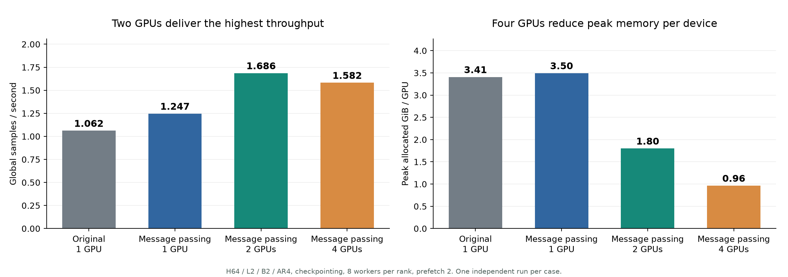
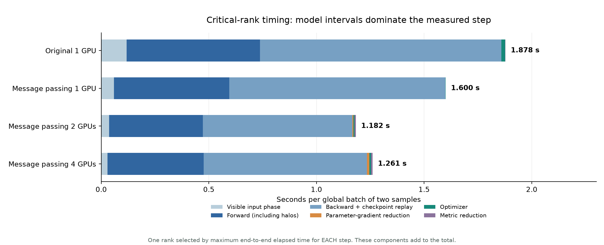
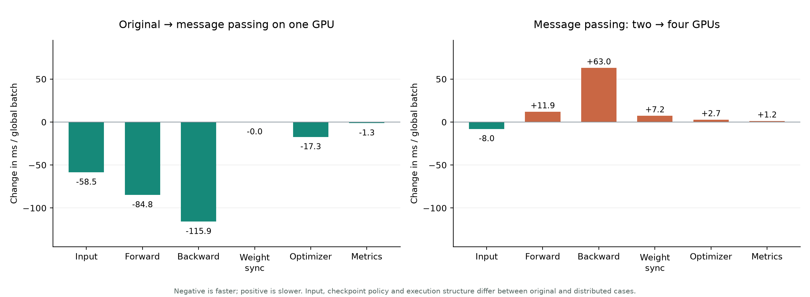
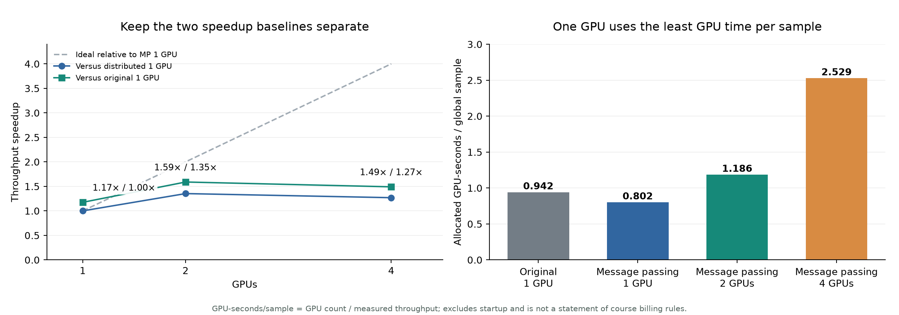
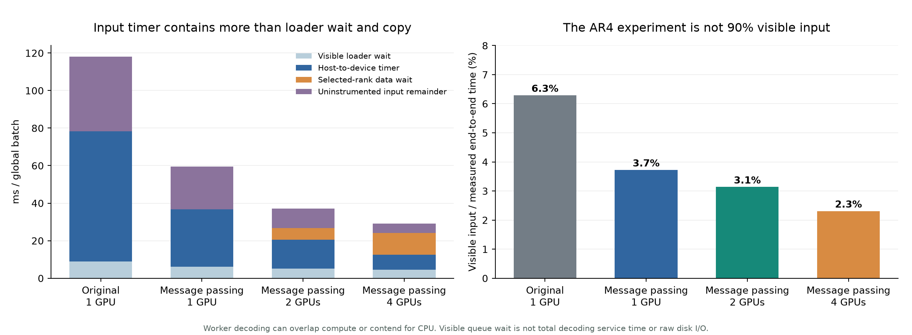
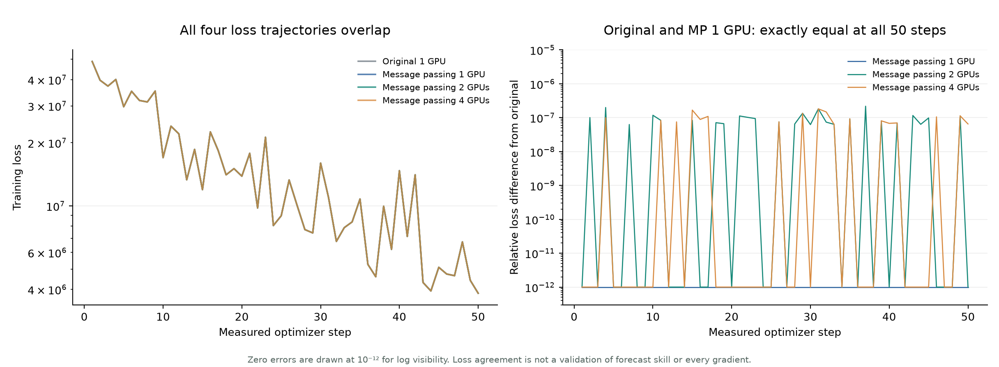
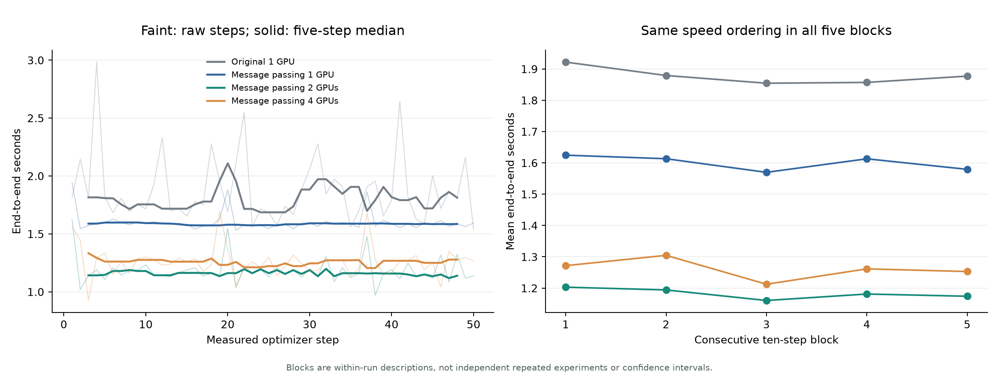
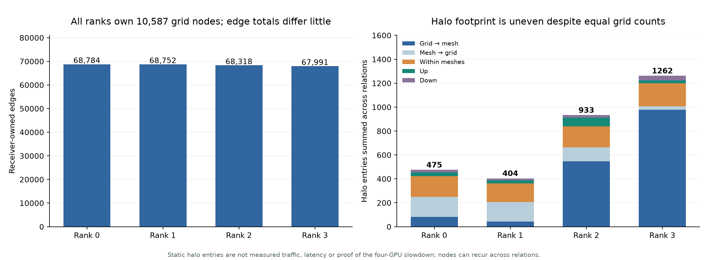

# Original GraphEFM versus distributed message passing: complete AR4 comparison

Source archive: `f40ed92`. Jobs **4981 / 4944 / 4949 / 4952**.
Read-only analysis: no model, loader, partitioning or training-job code was changed.

## 1. What the measurements support

**Two GPUs are fastest in this series.** They deliver 1.686 samples/s:
1.589× the original one-GPU reference and 1.353× our distributed
one-GPU implementation. Four GPUs still outperform the original, but deliver
6.2% less throughput than two GPUs.

**Memory distribution works well.** Peak allocated memory falls from 3.408
GiB in the original to 0.965 GiB per GPU on four GPUs, a
71.7% reduction. A capacity benefit and a throughput benefit are separate results.

**The current AR4 hot loop is not 90% visible data loading.** Visible input accounts for
6.3% in the original and 3.7% / 3.1% /
2.3% in MP 1/2/4. Forward and backward intervals now dominate.
They include communication and scheduling gaps; these are not isolated GPU arithmetic times.

**Numerical consistency is strong.** Original and MP 1 GPU have exactly the same scalar loss at
every one of the 50 measured optimizer steps. Maximum per-step relative loss differences on
2/4 GPUs are 2.18e-07 / 1.82e-07.



| Case / job | Samples/s | Speedup vs original | Speedup vs MP 1 | Mean E2E ms | p95 E2E ms | Peak GiB/GPU |
| --- | --- | --- | --- | --- | --- | --- |
| Original 1 GPU / 4981 | 1.062 | 1.000× | — | 1877.749 | 2549.284 | 3.408 |
| MP 1 GPU / 4944 | 1.247 | 1.175× | 1.000× | 1599.897 | 1862.215 | 3.495 |
| MP 2 GPUs / 4949 | 1.686 | 1.589× | 1.353× | 1182.490 | 1476.230 | 1.801 |
| MP 4 GPUs / 4952 | 1.582 | 1.490× | 1.269× | 1260.570 | 1562.561 | 0.965 |

## 2. What was actually held constant

All four cases use `global_cluster_graph`, 42,348 ocean grid nodes, 8,456 fine and 2,097 coarse
mesh nodes, H64 on grid/mesh/edge/latent representations, two decoder processor layers,
one layer in each encoder, one hidden layer per MLP, global batch size two, two input states
and **four autoregressive forecast steps**. There are 645,020 trainable parameters per rank.
They use FP32, the learned isotropic prior and learned diagonal posterior, WMSE likelihood
plus KL with beta one, CRPS weight zero, no observation-noise sampling, original clamping
and density feedback. AdamW uses LR 0.001, betas (0.9, 0.95), weight decay 0.1.

Every case uses eight persistent spawn workers **per rank**, prefetch factor two **per worker**,
shuffle seed 42, no pinned host memory and no dropped final batch. This is 8 / 8 / 16 / 32
workers in total across original / MP1 / MP2 / MP4. Prefetch two can queue up to two batches
per worker; it does not mean two workers or two batches total. Worker count does not allocate CPU cores.

All cases run on `studgpu-node02.inf.ethz.ch`, NVIDIA GeForce GTX 1080 Ti, Python 3.12.3,
PyTorch 2.14.1+cu126, CUDA runtime 12.6. Each measures 50 optimizer steps after ten warmups,
or 100 measured samples. Each optimizer step contains four forecast steps. The measurement is
not a full training epoch or a convergence/forecast-quality study.

The original benchmark code is commit `675c2bc`; MP runs use `aa5829a`. These are intentionally
different harness commits. This analysis verifies that all 13 recorded original model,
message-passing, loss and loader source blobs match the frozen global-model source `76b30d7`
in **both** commits. Tracked files were clean in every run.

The original and distributed paths use the same seed/scenario sequence by different mechanisms:
the original samples with the default CUDA generator and checkpoint RNG preservation; MP draws
explicit global latent noise outside checkpoints and selects local top-mesh nodes.
Shapes/dtypes/sums of the first effective batch match after canonicalizing unused empty tensors.
This is a fingerprint, not a cryptographic hash of every input value. Its agreement plus the
full measured loss trajectory provides stronger evidence than either check alone.

## 3. Important boundaries of the original-versus-MP comparison

The original reference really calls the unchanged `GraphEFM.training_step` and original
`WeatherDataset`; only metric logging is captured by an adapter. Both paths use the same
standalone CUDA timing/AdamW harness, rather than the complete Lightning trainer lifecycle.
Validation loops, schedulers, checkpoint-file saving and external experiment logging are not timed.

Three recorded settings differ intentionally:

| Setting | Original | Distributed |
| --- | --- | --- |
| Input layout | Original full rectangular Zarr, ocean mask applied during sampling | Prebuilt rank-local ocean shards |
| Non-reentrant checkpoint early stopping | Original default: enabled | Disabled to replay the full collective schedule |
| Data-phase rank barrier | None | Present for multiple ranks; effectively no-op for one |

The original stages its full directory into job-local temporary storage. MP stages the selected
shard layout; its graph/config/statistics still come from the scratch source. Startup paths
therefore also differ. The original full-grid data has 61,200 rectangular cells before masking;
the effective state, forcing and atmosphere tensors contain the same 42,348 ocean nodes.

Consequently the original-to-MP1 result is a **bundle of input-layout and execution changes**.
It is not a measurement of an isolated halo overhead: MP1 has no inter-GPU halo traffic at all.
Even the compute interval can be influenced by background loader CPU work, tensor layout,
Python dispatch and checkpoint scheduling. An observed improvement is real for these runs;
its cause needs controlled experiments and independent repetitions.

## 4. Full phase comparison and the aggregation trap

The following means reproduce the result JSON summaries. Multi-rank summaries take the
maximum rank for each metric independently at every step. They are useful worst-rank
diagnostics, but **their phase maxima must not be added to build a time stack**.
Also, `compute_ms`, `step_ms` and `end_to_end_ms` are nested totals, not additional phases.

| Published phase mean, ms | Original 1 GPU | MP 1 GPU | MP 2 GPUs | MP 4 GPUs |
| --- | --- | --- | --- | --- |
| data_distribution_ms | 118.082 | 59.559 | 37.181 | 29.969 |
| data_read_ms | 8.871 | 6.058 | 6.244 | 8.336 |
| host_to_device_ms | 69.325 | 30.585 | 18.002 | 11.977 |
| batch_broadcast_ms | 0.000 | 0.000 | 0.000 | 0.000 |
| data_rank_wait_ms | 0.000 | 0.001 | 13.087 | 15.802 |
| forward_ms | 620.046 | 535.205 | 435.797 | 449.412 |
| backward_ms | 1120.115 | 1004.254 | 697.028 | 761.746 |
| gradient_sync_ms | 0.019 | 0.002 | 7.072 | 13.794 |
| optimizer_ms | 17.946 | 0.632 | 7.609 | 10.823 |
| compute_ms | 1758.127 | 1540.093 | 1144.745 | 1230.498 |
| metric_reduce_ms | 1.541 | 0.245 | 11.142 | 16.488 |
| step_ms | 1759.668 | 1540.338 | 1145.593 | 1231.535 |
| end_to_end_ms | 1877.749 | 1599.897 | 1182.490 | 1260.570 |

For additive attribution, the analysis selects the rank with the largest end-to-end interval
at each step, then takes every phase from that same rank. The resulting components sum to
the measured maximum end-to-end time:

| Additive critical-rank component, ms | Original 1 GPU | MP 1 GPU | MP 2 GPUs | MP 4 GPUs |
| --- | --- | --- | --- | --- |
| data_distribution_ms | 118.082 | 59.559 | 37.092 | 29.114 |
| forward_ms | 620.046 | 535.205 | 434.692 | 446.601 |
| backward_ms | 1120.115 | 1004.254 | 695.464 | 758.445 |
| gradient_sync_ms | 0.019 | 0.002 | 4.029 | 11.244 |
| optimizer_ms | 17.946 | 0.632 | 4.906 | 7.621 |
| metric_reduce_ms | 1.541 | 0.245 | 6.306 | 7.546 |



Observed throughput counts actual measured samples over the complete measured wall-clock window.
It is the primary speedup metric. It differs slightly from `2 / mean(end_to_end_seconds)`
because loop bookkeeping lies outside the per-step interval. That outer-loop remainder is
6.31 / 4.13 / 3.44 /
3.68 ms/step in the four cases; it is not silently assigned to data or halos.

## 5. Original one GPU → distributed one GPU

MP1 improves measured throughput by **17.5%** and reduces mean
end-to-end time by 277.9 ms
(14.8%).
The input phase falls by 58.5 ms, forward by 84.8 ms, backward by 115.9 ms, optimizer by 17.3 ms
and metric reduction by 1.3 ms. The model-step interval falls from 1,759.7 to 1,540.3 ms.

This does **not** show a 17.5% improvement caused by halo communication. No halo transfer is
needed with one rank. It shows that the distributed training structure plus sharded input
does not incur an observed net single-device slowdown in this experiment.

The optimizer is especially useful as a diagnostic: it is the same AdamW and parameter count,
yet its recorded interval is 17.95 versus 0.63 ms. A change of this size cannot simply be
attributed to fewer graph messages. CUDA events span elapsed stream time between recorded
events, which may include idle time while the host schedules work. The original log explicitly
warns about eight loader workers with a suggested CPU maximum of two. Full-grid background
sample preparation is a plausible source of extra host pressure, but CPU utilization, actual
run-time affinity per rank and kernel traces are not recorded. This remains a hypothesis.



## 6. Distributed scaling: why two GPUs currently win

The correct internal strong-scaling denominator is distributed MP1, not the slower original:
MP2 is **1.353×** (67.6% efficiency);
MP4 is **1.269×** (31.7% efficiency).
The original-relative factors 1.589× / 1.490× answer a
different question: the improvement of the complete new execution over the original reference.

From MP1 to MP2, published forward drops from 535.2 to 435.8 ms and backward from 1,004.3 to
697.0 ms. These savings dominate the added gradient synchronization and other coordination.
From MP2 to MP4, mean E2E instead rises by 78.1 ms (6.6%).
The exact critical-rank decomposition is:

| Two → four GPUs | Change, ms/global batch |
| --- | --- |
| data_distribution_ms | -7.978 |
| forward_ms | +11.909 |
| backward_ms | +62.980 |
| gradient_sync_ms | +7.215 |
| optimizer_ms | +2.715 |
| metric_reduce_ms | +1.241 |

Backward contributes about 63 ms of the extra 78 ms. Forward adds about 12 ms.
The visible input phase actually improves by about 8 ms, so it does not explain this reversal.
The separately recorded parameter-gradient reduction is only one communication stage;
halo transfers and checkpoint replay are inside forward/backward. Its small size does not
prove that all communication is small. Conversely, larger forward/backward intervals do not
prove that the network alone caused the slowdown.

Plausible mechanisms to distinguish are smaller local kernels with more launch overhead,
foreground CPU contention as rank/worker counts rise, halo latency and packing, unequal
boundary work, repeated checkpoint communication, and global synchronization. None has an
isolated measured contribution yet.



## 7. Data loading, workers, prefetch and the remaining timer gap

| Input component, selected critical rank (ms) | Original 1 GPU | MP 1 GPU | MP 2 GPUs | MP 4 GPUs |
| --- | --- | --- | --- | --- |
| data_read_ms | 8.871 | 6.058 | 5.170 | 4.570 |
| host_to_device_ms | 69.325 | 30.585 | 15.274 | 8.050 |
| data_rank_wait_ms | 0.000 | 0.001 | 6.336 | 11.412 |
| Uninstrumented remainder | 39.885 | 22.916 | 10.311 | 5.082 |
| Total visible input | 118.082 | 59.559 | 37.092 | 29.114 |

`data_read_ms` measures waiting for a prepared CPU batch from the loader, including immediate
queue/collation work encountered by the caller. With background workers it does **not** measure
all Zarr reading/decompression service time. A 6 ms wait can coexist with substantial decoding
work while the previous graph step runs. `host_to_device_ms` includes the host-side transfer
call and completion wait; it is not an isolated DMA-kernel or raw PCIe-bandwidth measurement.

There is an uninstrumented remainder inside the enclosing data interval: 39.9 ms in the
original, 22.9 ms in MP1 and smaller values on the selected multi-GPU ranks. Code places the
inner transfer timestamp before returning from `stream.next`, while the outer timestamp is
after returning and replacing the previous batch. Cleanup, IPC tensor lifetime and scheduling
are possible contributors. Existing timers cannot identify which. It must not be mislabeled
as extra disk reads, decompression or halo communication.

If **only** the visible input interval vanished and every model interval stayed unchanged,
the maximum throughput factors would be 1.067× /
1.039× / 1.032× /
1.024×. For the fastest two-GPU case this is only
about 3.2%. This conditional bound is not a bound on all loader improvements: reducing
background CPU contention could also shorten the model intervals.

More workers or prefetch are therefore not the first blind sweep to run now. Freeze 8/P2
for attribution. A preload/cached-batch mode is useful as a **bounded diagnostic**, with
explicit host/GPU memory budgets and setup time, rather than a promise to preload an
arbitrarily large production dataset. Larger models may hide more input latency but do not
repair the measured scaling mechanism; increasing width now would change the question.

The historical AR1 measurements had a different forecast length and loader policy. Their
large visible input fraction and this AR4 result can both be correct. The improvement cannot
be credited to AR4 alone because the worker/prefetch setup changed too.



## 8. Numerical agreement and run-to-run uncertainty

All first-batch fingerprints and initial losses pass the comparison tolerance. The original
initial loss is 1,102,826,112, equal to MP1 and MP4; MP2 differs by 128 (roundoff scale).
Mean measured loss is 15698777.445, 15698777.445, 15698777.880,
15698777.600. Original and MP1 are exactly equal at every recorded scalar-loss step;
the multi-GPU maximum relative differences are below 2.2e-7.

This supports preservation of this training trajectory. It does not establish every full-H64
GPU gradient or parameter element is identical, validate a scientific forecast ensemble,
or demonstrate long-run convergence. Separate earlier equivalence tests checked forecasts,
gradients and AdamW updates on a small CUDA/NCCL graph, and the physical H64 case on CPU.
The four-run performance result is additional evidence, not a replacement for those tests.



| Case | Within-run CV | Block means, ms (five consecutive groups of ten steps) |
| --- | --- | --- |
| Original 1 GPU | 15.4% | 1921.7, 1878.9, 1854.3, 1856.8, 1877.0 |
| MP 1 GPU | 4.9% | 1624.5, 1613.1, 1569.7, 1612.9, 1579.3 |
| MP 2 GPUs | 9.6% | 1202.9, 1194.1, 1160.4, 1181.1, 1174.0 |
| MP 4 GPUs | 10.3% | 1271.7, 1304.6, 1212.3, 1261.4, 1252.9 |

Original > MP1 > MP4 > MP2 in elapsed time in all five ten-step blocks. The fastest case is
not selected by a single unusually fast batch. However there is **one independent run per
configuration**. These 50 steps share one job, loader state, evolving model and machine
conditions. They must not be treated as 50 independent replications or used to manufacture
confidence intervals for a configuration's true speed. The original's 15.4% within-run CV
also argues for repeated paired measurements before attributing its improvement causally.



## 9. Memory, preflight lifetime and resource efficiency

Allocated peaks are 3.408 / 3.495 / 1.801 / 0.965 GiB per GPU. MP4 reduces per-device memory
by 72.4% relative to MP1 and 71.7% relative to the original. This allows larger problems to
fit even when four GPUs do not maximize throughput for H64. Reserved memory is allocator
capacity and should not be substituted for live allocated memory.

MP1's allocated peak is 89.4 MiB above the original. A code-visible measurement difference
matters here: `model_parallel_real.py` retains `preflight_batch` throughout measurement;
the original runner reassigns its `batch` variable and releases the first input batch.
The effective global input batch is 97,569,856 bytes (93.1 MiB).
This can influence the apparent one-GPU memory difference, alongside graph buffers/layout.
It is not an exact allocation attribution; do not subtract the payload from the peaks and
claim a corrected model-only peak. The next measurement should align buffer lifetimes first.

| Case | GPU-seconds/sample | Relative to MP 1 GPU | Peak reserved GiB/GPU |
| --- | --- | --- | --- |
| Original 1 GPU | 0.942 | 1.17× | 3.889 |
| MP 1 GPU | 0.802 | 1.00× | 3.971 |
| MP 2 GPUs | 1.186 | 1.48× | 2.080 |
| MP 4 GPUs | 2.529 | 3.15× | 1.107 |

GPU-seconds/sample equals allocated GPU count divided by observed samples/s in the steady
window. It excludes initialization and is not the course's billing formula. MP2 uses about
1.48× MP1 GPU time per sample; MP4 about 3.15×. For this configuration MP1 minimizes this
resource metric, MP2 minimizes wall time, and MP4 minimizes peak memory per GPU.

## 10. Four-way ownership: balance counts versus boundary cost

| Rank | Owned grid | Owned mesh levels | Incoming edges | Halo entries across relations | G2M halo entries |
| --- | --- | --- | --- | --- | --- |
| 0 | 10587 | [2114, 525] | 68784 | 475 | 81 |
| 1 | 10587 | [2114, 524] | 68752 | 404 | 43 |
| 2 | 10587 | [2114, 524] | 68318 | 933 | 546 |
| 3 | 10587 | [2114, 524] | 67991 | 1262 | 978 |

Grid counts are identical and receiver-owned edge totals differ by only about 1.2% across
ranks. Static halo entries vary from 404 to 1,262, driven particularly by G2M. These entries
are distinct remote sender states **within a relation**, summed over relations. The same
global node may occur in several relations. They are not the number of cut edges, actual
traffic bytes, message calls or communication time.

Near-equal per-rank elapsed time does not prove equal useful work: ranks can wait for each
other. Conversely unequal halo counts are not proof of the measured slowdown. To turn the
partition footprint into actionable weights, record relation use counts, actual batch and
feature dimensions, directed send/receive bytes and packing/wait/compute timings for forward,
checkpoint replay and reverse-gradient traffic.



The current communication code posts grouped `isend`/`irecv` operations and waits before
using received features. Transfers between peers can be concurrent within that exchange;
there is no deliberately scheduled local-edge MLP computation before that wait. This is
different from an implementation that explicitly overlaps interior work with halo arrival.

## 11. Startup and what a short job costs

| Case | Staging (s) | Init through preflight, excl. staging (s) | Measured window (s) | Benchmark timestamps (s) |
| --- | --- | --- | --- | --- |
| Original 1 GPU | 22.9 | 146.3 | 94.2 | 267.3 |
| MP 1 GPU | 11.3 | 106.2 | 80.2 | 206.6 |
| MP 2 GPUs | 5.7 | 108.7 | 59.3 | 180.7 |
| MP 4 GPUs | 7.9 | 140.0 | 63.2 | 216.3 |

Staging is outside initialization and the measured window. Initialization includes model,
loader startup and preflight; those substages cannot all be labeled worker spawning.
Benchmark timestamp elapsed includes warmup and other benchmark work but excludes staging,
earlier interpreter/process-group setup and final process cleanup. The original accounting
file records `COMPLETED|0:0`, not a full Slurm elapsed/resource record, so no exact original
job duration or bill is inferred. Short-run end-to-end job costs differ from steady throughput.

## 12. Recommended next experiments, in order

### A. Establish a reproducible timing and memory reference

**Question:** Does the observed ordering persist, and how much of original → MP1 is input
layout versus checkpoint policy versus training execution structure?

Keep H64/L2/B2/AR4, FP32, global batch two, AdamW, seeds and 8/P2 fixed. Prepare a one-GPU
control ladder: (A) original/full-grid/early-stop-on, (B) original/ws1 ocean shard/early-stop-on,
(C) original/ws1 shard/early-stop-off, (D) MP1/ws1 shard/early-stop-off. This reuses the
original model and changes only the harness; no changes to its scientific equations are needed.
Align preflight batch lifetimes, queue state, warmup and measurement counts. Save the
historical measurements unchanged; new runs get new identifiers.

Record the actual CPU affinity/cpuset per rank and inherited worker affinity, allocated CPUs,
GPU UUID/topology, GPU/CPU utilization, source/shard hashes and runtime versions. The log's
two-core warning is evidence of a constraint, not a complete measurement of CPU utilization.
Use at least three independent repetitions of the selected cases, rotating execution order.
Do not silently give the one-GPU case extra CPU resources when moving to a different allocation.
Only claim an isolated effect if its control differs in the intended single factor.

**Deliverable / exit:** unchanged numerical checks, aligned buffer lifetime, per-case medians
and ranges from independent runs, and an explicit account of each remaining configuration difference.

### B. Profile current two- and four-GPU execution before optimizing communication

**Question:** Is the four-GPU penalty primarily foreground CPU launch starvation, smaller
local kernels, halo/wait cost, replay or some combination?

Use separate short traced jobs alongside an untraced timing reference. Instrument embeddings,
G2M, mesh-0 and mesh-1 layers, up/down, M2G, loss, checkpoint replay, parameter-gradient
reduction and optimizer. Capture CPU and CUDA activity on every rank. Count actual posted
P2P messages/bytes and annotate pack, posting, waiting and dependent compute without adding
global synchronization at every layer. CPU `Work.wait` duration alone is not network latency.

Add a bounded compute-only diagnostic using the same prepared batches across cases, after
stopping background loader work; retain the original end-to-end mode as a separate experiment.
This reveals whether background decoding affects model dispatch. Add timestamps around the
return/cleanup boundary of `stream.next` to explain the 5–40 ms input remainder. Profiled
timings are for attribution; report speedups from untraced repetitions.

**Deliverable / exit:** a per-rank critical timeline and measured attribution of the dominant
two → four-GPU increase. A later implementation is selected by that evidence, not halo counts alone.

### C. Integrate the team's external partition files on the current AR4 runtime

**Question:** Can the team's owner maps reduce the measured boundary/imbalance cost without
changing model/data semantics?

Port the NPZ owner-array loader/validation from `lassi-partition-benchmark`, not its old AR1
benchmark wholesale. Bind owner arrays to exact graph/node/edge ordering, world size and a
partition hash. Rebuild matching data shards and manifests; existing geographic shards cannot
be used with arbitrary new owner arrays. Keep scientific tensors, temporal sample order and
8/P2 unchanged. Check output, loss, gradients and AdamW equivalence before timing.
Compare current geographic ownership with the team's proposed owners at H64 first, using
per-relation measured compute/communication weights. The partition design remains the team's task.

**Deliverable / exit:** validated owner/shard identities, unchanged numerical results, measured
per-rank balance and halo traffic, then repeatable untraced throughput and memory improvements.

### D. Implement one targeted runtime change after attribution

If CPU gaps dominate, test explicit CPU placement and a bounded CPU-thread policy before
adding workers; any reduction from 8/P2 is a separately labeled tuning experiment. If packing
or allocation dominates, reuse stable buffers and index plans and validate stream lifetimes.
If waiting dominates and independent local edges exist, overlap transfers with local edge
MLPs, then combine local/remote contributions using the full receiver degree and apply the
node update once. Preserve edge ordering, reverse halo gradients and the complete checkpoint
communication schedule. If small kernels dominate, investigate batching/fusion of equivalent
operations before increasing the model merely to make scaling look better.

Alex's branch offers related halo/Lightning and overlap work, but its grid/G2M/M2G remain
replicated and its archived overlap runs hit CUDA OOM. Align interfaces and memory budgets
before reuse. Nils's stage hooks and Lassi's trace attribution can help, but must wrap our
distributed path, not only the original model. Their numerical timing results use different
hardware/workloads and are not direct baselines for this series.

**Deliverable / exit:** one factor changed, all numerical/communication-order checks passed,
bounded memory, and improvement reproduced against the unchanged case.

### E. Characterize capacity and larger models after the mechanism is understood

Only then vary one of hidden width, processor depth or batch size at a time. Width changes
MLP work, activation memory and halo feature bytes; depth changes relation-use counts and
checkpoint work; batch size changes memory and arithmetic intensity. They are different
experiments and may have different scaling crossover points. Keep AR4 and the original H64
reference as anchors. Larger production datasets need a chunk/shard/cache strategy, not an
unbounded preload promise. CRPS/ensemble training and scientific forecast validation remain
separate workload extensions; this four-run comparison measures the ELBO configuration only.

## 13. Reproduction and evidence

Run from the repository root:

```bash
MPLCONFIGDIR=/tmp/njord-analysis-mpl \
  .venv/bin/python -m benchmarks.analyze_ar4_reference_comparison
```

`comparison.json` includes validated settings, source-file SHA256 hashes, both speedup
baselines, critical-rank components, per-rank data, startup, loss agreement and limitations.
`metrics.csv` reproduces published phase means; `critical-rank-phases.csv` contains additive
components; `rank-metrics.csv` retains per-rank means. PNG and vector PDF figures are under
`plots/`. The HTML presentation accompanies this report. All archived input JSONs are read-only.

Source-code checkpoints for interpretation: `benchmarks/original_graph_efm.py`,
`benchmarks/model_parallel_real.py`, `neural_lam/models/distributed_graph_efm_training.py`,
`neural_lam/distributed_message_passing.py`, and `benchmarks/TEAM_BRANCH_REVIEW_2026-11-22.md`.
The code-visible timer and preflight-lifetime findings should be verified in the next trace,
not silently treated as measured causal explanations.
